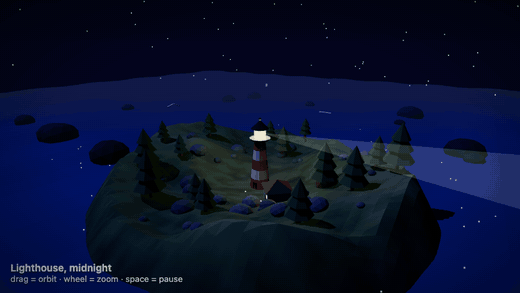
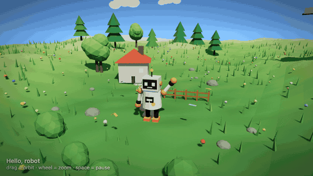
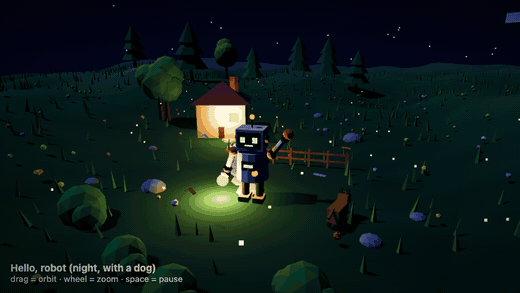

# Idea to 3D

**Turn an idea into an animated 3D scene with Claude Code.** A free, open-source skill: describe a scene in one sentence, get a low-poly 3D world you can orbit in your browser and change by talking.



> "Use idea-to-3d: a lighthouse on a cliff at night, its beam sweeping over a dark sea, two seagulls, a tiny boat."

No account, no API key, no network at runtime, no build step. Node 18+ and a browser.

🇫🇷 [Version française plus bas](#-en-français) · 🌐 [Page du projet](https://jackywest.com/idea-to-3d?utm_source=github&utm_medium=readme&utm_campaign=idea-to-3d)

## Install (30 seconds)

```bash
git clone https://github.com/jackywest/idea-to-3d.git
node idea-to-3d/skills/idea-to-3d/scripts/install.mjs
```

This copies the skill to `~/.claude/skills/idea-to-3d` (use `--project` for `./.claude/skills`, `--force` to replace an existing copy). Nothing else is touched. Prefer manual? Copy the folder `skills/idea-to-3d` yourself.

## Use

Open Claude Code in any folder and say:

```
Use idea-to-3d: a small robot waving hello on a grassy hill, a cottage and two pine trees behind it
```

Claude creates a new scene folder, writes `src/scene.js`, checks it in a real headless browser (console errors, blank or frozen frames), looks at the frames, then tells you how to open it:

```bash
cd my-scene && node serve.mjs      # http://127.0.0.1:5173/
```

Drag to orbit, wheel to zoom, space to pause. Then keep talking: *"make it night, give the robot a lantern, add a dog."*

## Three examples (all in `examples/`, all tested)

| | Prompt | Result |
|---|---|---|
| **A. First scene** | a friendly robot waving on a hill, cottage, pine trees |  |
| **B. Creative** | a lighthouse at night, sweeping beam, seagulls, a boat |  |
| **C. Modify A** | make it night, add a lantern and a dog, slow the wave |  |

Run any of them without Claude:

```bash
node skills/idea-to-3d/scripts/scaffold.mjs /tmp/demo --scene examples/b-lighthouse-night/scene.js
cd /tmp/demo && node serve.mjs
```

## How it works

The skill ships a small template: `three.js` (vendored, unmodified), a runtime with four light moods (`day`, `sunset`, `night`, `studio`), an orbit camera, a deterministic clock (`?t=3.5` freezes a frame) and a low-poly toolbox. The only file the model writes is `src/scene.js`, with a tiny contract (`build` + `update(t)`), so results are reproducible and easy to modify. Scripts:

| Script | What it does |
|---|---|
| `scaffold.mjs` | copies the template into a new folder, never overwrites |
| `lint-scene.mjs` | rejects network calls, `eval`, external URLs, `Math.random`, wall-clock time |
| `capture.mjs` | serves the scene, loads it in headless Chrome, saves frames, fails on console errors or blank/frozen output (`npm i -D puppeteer-core`) |
| `install.mjs` | installs the skill |

## Limits (honest)

- Low-poly procedural scenes: boxes, cylinders, cones, spheres. No imported 3D models, textures or physics.
- Quality depends on the prompt and on the model; the skill adds composition rules and a visual check, not magic.
- `capture.mjs` needs Chrome or Chromium. Without it the skill can only lint, and says so.
- It makes scenes for the browser. It does not export video.

## Security

No telemetry, no network at runtime, local server bound to `127.0.0.1`, writes only inside the scene folder. Details in [SECURITY.md](SECURITY.md). Three.js is MIT, see [THIRD_PARTY.md](THIRD_PARTY.md).

## Contribute

New helpers, scenes and fixes are welcome: [CONTRIBUTING.md](CONTRIBUTING.md). If this saved you an hour, a ⭐ on the repo helps other people find it.

Made by [Jacky West](https://jackywest.com/idea-to-3d?utm_source=github&utm_medium=readme&utm_campaign=idea-to-3d). Want to go further and turn scenes into rendered videos with a director agent? That's a separate, paid kit: [Kit Reels IA](https://jackywest.com/kit-reels-ia?utm_source=github&utm_medium=readme&utm_campaign=idea-to-3d). This skill is, and stays, free and MIT.

---

## 🇫🇷 En français

**Transforme une idée en scène 3D animée avec Claude Code.** Un skill gratuit et open source : décris une scène en une phrase, obtiens un monde 3D low-poly que tu fais tourner dans ton navigateur et que tu modifies en parlant.

**Installation**

```bash
git clone https://github.com/jackywest/idea-to-3d.git
node idea-to-3d/skills/idea-to-3d/scripts/install.mjs
```

**Utilisation** : dans Claude Code, dis par exemple : « Utilise idea-to-3d : un petit robot qui salue sur une colline, une maisonnette et deux sapins derrière ». Claude crée un dossier, écrit `src/scene.js`, le vérifie dans un vrai navigateur sans interface (erreurs console, images vides ou figées), regarde les images, puis te donne la commande : `node serve.mjs` et l'adresse `http://127.0.0.1:5173/`. Glisse pour tourner, molette pour zoomer, espace pour mettre en pause. Ensuite : « passe en nuit, donne une lanterne au robot, ajoute un chien ».

**Exemples** : A robot (première scène), B phare de nuit (créatif), C modification de A (nuit + lanterne + chien), tous dans `examples/` et testés.

**Limites** : scènes procédurales low-poly, pas de modèles importés ni de physique ; la qualité dépend du prompt ; la vérification visuelle demande Chrome ou Chromium ; pas d'export vidéo.

**Sécurité** : aucune télémétrie, aucun réseau à l'exécution, serveur local sur `127.0.0.1`, écriture limitée au dossier de la scène. Voir [SECURITY.md](SECURITY.md).

Fait par [Jacky West](https://jackywest.com/idea-to-3d?utm_source=github&utm_medium=readme&utm_campaign=idea-to-3d). Si ça t'a fait gagner du temps, une ⭐ aide d'autres personnes à le trouver. Pour aller plus loin (rendre ces scènes en vidéos avec un agent réalisateur), il existe un kit payant séparé : [Kit Reels IA](https://jackywest.com/kit-reels-ia?utm_source=github&utm_medium=readme&utm_campaign=idea-to-3d). Ce skill reste gratuit et MIT.
