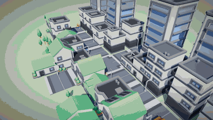
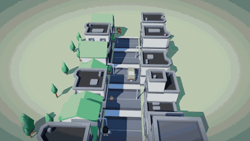
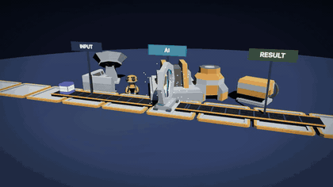

# Idea to 3D

**Turn an idea into a short animated 3D film scene with Claude Code.** You describe a story in a sentence; the skill casts characters, builds a small world from real cartoon assets, animates the action, and directs a camera that follows what happens. Free, open source (MIT), runs locally in your browser. No account, no API key, no network at runtime.



> "Use idea-to-3d: a courier carries a parcel through a small town, waits for a taxi, crosses the street and hands it to a police officer."

🇫🇷 [Français plus bas](#-en-français) · 🌐 [Project page](https://jackywest.com/idea-to-3d?utm_source=github&utm_medium=readme&utm_campaign=idea-to-3d) · [Changelog](CHANGELOG.md) · [Migrating from v0.1](MIGRATION.md)

## What is new in v0.2

v0.1 made small procedural scenes with an orbiting camera. v0.2 is directed:

- **A Director**: actors walk paths with real animation clips, carry and throw props, turn to look, react. Shots are motivated (tracking, push-in, reveal, pan, group framing) and every moving shot carries a one-line reason.
- **Real assets**: a bundled CC0 pack (city, cars, characters, a robot, sci-fi machines) instead of boxes. Bring your own GLB too.
- **A cinematography audit** that samples the whole timeline: is the subject framed, big enough, un-occluded; is the camera ever inside a wall; do bodies clip through each other; are moves abrupt, unmotivated or is nothing moving. It prints *when* a problem occurs and writes a contact sheet and an MP4 preview, so the model has to look at its own film.
- Everything still deterministic, offline, MIT. v0.1 scenes still run.

## Install (30 seconds)

```bash
git clone https://github.com/jackywest/idea-to-3d.git
node idea-to-3d/skills/idea-to-3d/scripts/install.mjs
```

Copies the skill to `~/.claude/skills/idea-to-3d` (`--project` for `./.claude/skills`, `--force` to replace). Nothing else is touched. Needs Node 18+. For the visual QA: `npm i -D puppeteer-core` in the scene folder and Chrome or Chromium.

## Use

In Claude Code, in any folder:

```
Use idea-to-3d: a robot delivers a parcel to a woman at her door, trips on a cone, the parcel flies, she reacts.
```

Claude writes the story beats, scaffolds a new folder, writes `src/scene.js`, runs the audit, looks at the contact sheet and the preview video, fixes what is wrong, then gives you the command:

```bash
cd my-scene && node serve.mjs      # http://127.0.0.1:5173/
```

Press **C** to leave the camera work and orbit freely, space to pause. Then keep talking: *"push in slower on her face", "make it dusk", "add a second taxi".*

## Three demos (all in `examples/`, all pass the audit, all reproducible with the free pack)

| Demo | Prompt | Film |
|---|---|---|
| **A. City + dynamic camera** ([prompt](examples/a-city-courier/prompt.md)) | a courier crosses a town, waits for a taxi, hands over a parcel |  |
| **B. Cartoon action** ([prompt](examples/b-robot-mishap/prompt.md)) | a robot trips on a cone, the parcel flies, she reacts |  |
| **C. Information, staged** ([prompt](examples/c-ai-pipeline/prompt.md)) | three tasks go through an AI gate and come out finished |  |

Full-quality MP4s are in `docs/media/`. Run any demo yourself:

```bash
node skills/idea-to-3d/scripts/scaffold.mjs /tmp/demo --scene examples/b-robot-mishap/scene.js
cd /tmp/demo && node serve.mjs
```

The v0.1 demos are kept in `examples/legacy/` and `docs/media/legacy-v0.1/`.

## How it works

`template/` is a small Three.js project: a runtime (four moods, tone mapping, sky), `kit.js` (primitives, terrain, water, scatter), **`cine.js`** (Director + audit), `assets.js` (GLB loader, skinned characters, clip maps), `city.js` (an ASCII map becomes roads, buildings facing the street, trees, lamps) and a local static server. The model writes one file, `src/scene.js`: build the world, describe the action on a timeline, list the shots. Everything is a pure function of time, so a scene renders the same way every time.

| Script | What it does |
|---|---|
| `scaffold.mjs` | copies the template and the asset pack into a new folder, never overwrites |
| `lint-scene.mjs` | guard rail: rejects network calls, `eval`, external URLs, `Math.random`, wall-clock time (a regex check, not a sandbox) |
| `cine-qa.mjs` | audit + contact sheet + MP4 preview (`--video 15`, `--gpu` for speed) |
| `capture.mjs` | frames at chosen times, console errors, blank or frozen output |
| `install.mjs` | installs the skill |

## Honest limits

- The audit measures framing, clearance, clipping, motion and motivation. It cannot judge beauty, humour or whether the story is clear: that still needs eyes on the contact sheet and the video, which is why the skill makes the model look.
- Low-poly cartoon look. No physics engine: collisions are avoided by construction (lanes, bounding boxes), not simulated. No lip-sync, no facial expressions beyond what the models provide.
- The bundled pack is small (33 models, 3.7 MB). Bring your own GLB for anything specific.
- Visual QA needs Chrome/Chromium; without it the skill can only lint and must say so.
- Runs in the browser. It does not export a finished video file (the preview MP4 is a QA aid rendered from your own browser).

## Assets and licences

Code: MIT. Bundled models: **CC0 1.0** (Kenney city, car, character and space kits; RobotExpressive by Tomás Laulhé/Quaternius, conversion by Don McCurdy; three.js is MIT). Credit is appreciated, not required. See [`skills/idea-to-3d/assets/NOTICE.md`](skills/idea-to-3d/assets/NOTICE.md) and each pack's `LICENSE.txt`. Third-party assets keep their own licence; they are not relicensed as MIT. Details in [THIRD_PARTY.md](THIRD_PARTY.md).

## Security

No telemetry, no network at runtime, local server on `127.0.0.1`, writes only inside the scene folder, model files read only from inside the project. See [SECURITY.md](SECURITY.md).

## Contribute

Helpers, scenes, assets with a clear licence, fixes: [CONTRIBUTING.md](CONTRIBUTING.md). If this saved you an afternoon, a ⭐ helps others find it.

Made by [Jacky West](https://jackywest.com/idea-to-3d?utm_source=github&utm_medium=readme&utm_campaign=idea-to-3d). To go further and turn scenes into produced Reels with a director agent, there is a separate paid kit: [Kit Reels IA](https://jackywest.com/kit-reels-ia?utm_source=github&utm_medium=readme&utm_campaign=idea-to-3d). This skill is, and stays, free and MIT.

---

## 🇫🇷 En français

**Transforme une idée en petite scène 3D animée, réalisée comme un mini-film, avec Claude Code.** Tu décris une histoire en une phrase : le skill choisit les personnages, construit un petit monde avec de vrais assets cartoon, anime l'action et dirige une caméra qui suit ce qui se passe. Gratuit, open source (MIT), local dans ton navigateur, sans compte ni clé d'API.

**Nouveautés v0.2** : un *Director* (acteurs, accessoires, plans motivés : suivi, travelling avant, révélation, panoramique), un pack d'assets CC0 inclus (ville, voitures, personnages, robot, machines), un **audit de cinématographie** (sujet cadré et assez grand, caméra jamais dans un mur, corps qui ne se traversent pas, mouvements motivés) et une **planche-contact + aperçu MP4** que le modèle doit regarder avant de livrer.

**Installation**

```bash
git clone https://github.com/jackywest/idea-to-3d.git
node idea-to-3d/skills/idea-to-3d/scripts/install.mjs
```

**Utilisation** : dans Claude Code : « Utilise idea-to-3d : un robot livre un colis à une femme devant sa porte, il trébuche sur un cône, le colis vole, elle réagit. » Puis `cd ma-scene && node serve.mjs` et ouvre `http://127.0.0.1:5173/`. Touche **C** pour quitter la caméra du film et tourner librement.

**Limites** : l'audit mesure le cadrage, les collisions, le mouvement ; il ne juge pas la beauté ni l'humour. Style low-poly cartoon, pas de moteur physique, pas d'export vidéo final. Pack d'assets réduit (33 modèles) : apporte tes propres GLB. Assets CC0 sous leur propre licence (pas MIT).

Fait par [Jacky West](https://jackywest.com/idea-to-3d?utm_source=github&utm_medium=readme&utm_campaign=idea-to-3d). Une étoile aide d'autres personnes à le trouver. Pour aller plus loin (produire des Reels), il existe un kit payant séparé : [Kit Reels IA](https://jackywest.com/kit-reels-ia?utm_source=github&utm_medium=readme&utm_campaign=idea-to-3d). Ce skill reste gratuit et MIT.
